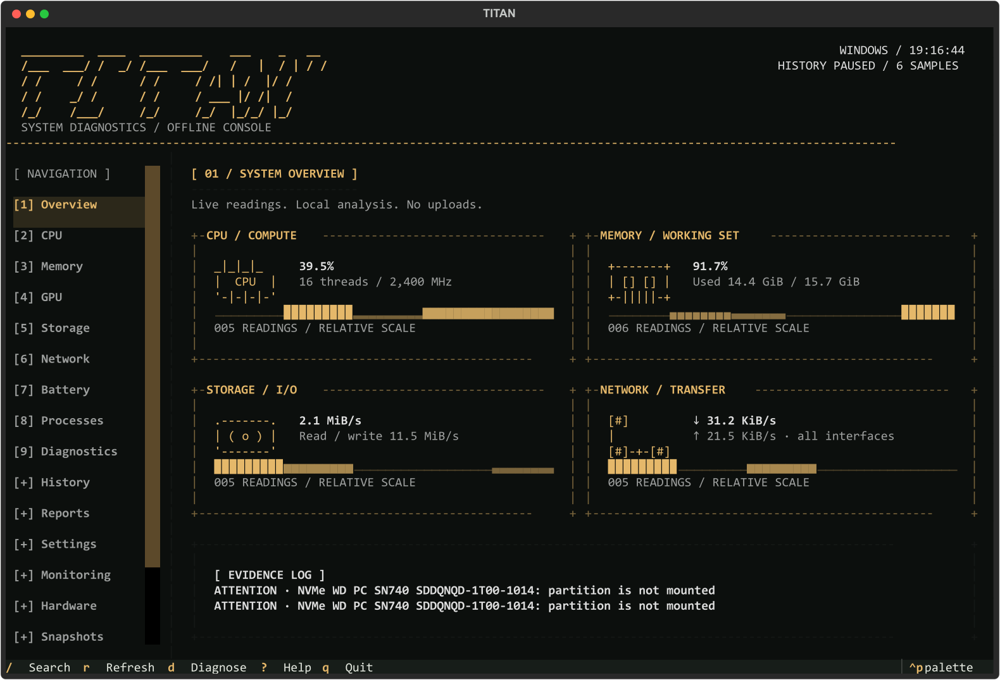

# TITAN

An offline system monitoring and diagnostics terminal for Windows and Linux.

Titan reads real operating system counters, explains diagnostic findings, and never modifies storage. History recording is off by default. Reports stay local and redact personal identifiers by default.

Titan 0.2.1 is available in [GitHub releases](https://github.com/MMH-4ALL/titan-diagnostics/releases/tag/v0.2.1), with verified Windows and Linux command installation. See [verification](docs/verification.md) for executed checks and hardware limitations.



This is a Textual terminal capture from the running application with actual local
measurements. It is not a mockup. Smaller-layout captures are in `docs/screenshots/`.

Titan's terminal identity uses an ASCII wordmark, component drawings, square
frames and an amber default theme. Small or short terminals use a compact header and
stacked instruments. Drawings are decorative; measurements and findings come
from the collectors. Traces show observed ranges rather than fixed percent axes.

## Install and run

Install a GitHub release with npm (Node.js 20+):

```console
npm install -g https://github.com/MMH-4ALL/titan-diagnostics/releases/latest/download/titan-diagnostics-0.2.1.tgz
titan
```

The published npm package includes Windows x64 and Linux x64 executables; those
targets do not need Python. Other supported architectures require Python 3.11+
with venv support and a first-run dependency download. Once prepared, Titan runs offline.

Linux curl installer (Python 3.11+ with venv support and curl):

```sh
curl -fsSL https://github.com/MMH-4ALL/titan-diagnostics/releases/latest/download/install.sh | sh
titan
```

For Windows curl/PowerShell, one-off npx runs, source installation, updates and
uninstall instructions, see [installation](docs/installation.md). The npm registry name is not yet
published; use the release tarball URL or a local `.tgz`.

Python 3.11 or newer:

```console
python -m pip install .
titan
titan --help
titan overview --json
titan storage diagnose
titan diagnose
titan doctor
```

Standalone Windows/Linux executables and Python distributions are available in [releases](https://github.com/MMH-4ALL/titan-diagnostics/releases/latest). Native executables are built independently on each platform.

## Keyboard

| Key | Action |
| --- | --- |
| 1–9 | Overview, CPU, Memory, GPU, Storage, Network, Battery, Processes, Diagnostics |
| / | Search pages and processes |
| Ctrl+P | Command palette |
| R | Refresh |
| D | Analyze collected evidence |
| ? / F1 | Context help |
| Q | Quit |
| Enter / X on Processes | Inspect / request termination |

Click a table header to sort. Use Tab to move focus. Text input receives ordinary letters and numbers without activating global shortcuts. On small terminals the sidebar hides; number shortcuts and the palette remain available.

## What Titan measures

CPU and per-core usage, frequency where accessible, memory and swap, running processes, physical drives and mounted volumes, disk transfer counters, network interfaces and rates, accessible connections, battery charge, and optional GPU/SMART telemetry. Missing data is explicitly unavailable, never replaced with fabricated measurements.

Five themes include Titan Dark, Arctic, Matrix, Monochrome and High Contrast. Themes preview in Settings and persist when saved. Live buffers are bounded; expensive device inventory is cached. Slow hardware queries run away from the UI thread.

Diagnostics use offline rules, with elapsed-time evidence for sustained CPU/memory/process activity. Findings include severity, evidence, explanation, possible causes, next steps, confidence and access requirements. Titan does not produce a universal health score or infer throttling from temperature.

## New monitoring tools

Open **Monitoring**, **Hardware map**, or **Snapshots** from the sidebar, `/` search,
or Ctrl+P. Monitoring adds a bounded drive connection timeline, per-device read/write
latency, IOPS and instantaneous queue depth, SMART counter trends, and direct
thermal-event evidence where the OS exposes it. The Hardware map draws actual
inventory using plain ASCII. Snapshots saves redacted before/after measurements
and compares metrics, hardware fingerprints, and CPU/OS metadata.

On Processes, I/O rates are shown beside CPU/RAM. **Trace process TCP traffic**
starts optional Windows EStats or Linux BCC tracing using existing permissions.
Windows I/O counters include network/device operations; they are not disk-only.
TCP scope and missing permissions remain explicit. On Network, enter your own
endpoint, port and duration to start or stop a TCP stability test.

SMART tracking starts off. Enable **Track SMART every 5 minutes** on Monitoring
to retain numerical counters and hashed drive identities locally. Manual checks
can be compared during the session without writing health history. Trackers do
not install tools, repair drives, or request elevation.

```console
titan monitor --duration 20 --json
titan monitor --trace-tcp --duration 20 --json
titan storage health --record --json
titan storage health-history --json
titan thermal --json
titan hardware-map
titan snapshot save before.json
titan snapshot save after.json
titan snapshot compare before.json after.json --json
titan network stability YOUR_HOST --port 443 --duration 60
```

See [the monitoring guide](docs/monitoring.md) for sampling, privacy, and platform
boundaries. The slanted five-row TITAN wordmark and hardware map use ASCII on
Windows and Linux; narrow terminals retain a compact header.

## Safety and privacy

Storage inventory, troubleshooting and optional SMART queries are read-only. Titan never initializes, partitions, formats, mounts, repairs or erases a drive. An unavailable SMART result does not establish drive health; a passed result does not guarantee reliability. Preserve important unrecovered files before maintenance.

Process termination requires confirmation and PID/start-time validation. Known critical processes, Titan and its ancestors, and identifiable service processes are protected. Unsaved work in a terminated application can be lost. Titan does not obtain elevated privileges automatically.

Network tests only run for a target explicitly entered by the user. No port scanning, cloud services, telemetry, subscriptions or uploads are included. Reports redact personal paths, usernames, device identifiers and network addresses by default; always review files before sharing them.

## History and reports

Enable recording in Settings or through `titan config`. SQLite stores aggregate metrics at a default ten-second interval with seven-day retention, and can aggregate time ranges. Pause recording at any time. Existing data is preserved if a database is corrupt; Titan reports the problem instead of deleting it.

Use Reports to save offline HTML, JSON, CSV or text locally, or use `titan report --help` for output paths and the detailed-report review flow. `titan history --help` provides custom time ranges. Process CSV exports are available in the process manager and CLI.

## Platforms and optional tools

| Capability | Windows | Linux |
| --- | --- | --- |
| CPU/memory/process/network counters | psutil | psutil |
| Physical drive inventory | Read-only PowerShell CIM and Storage cmdlets | lsblk JSON and sysfs |
| NVIDIA telemetry | nvidia-smi when installed | nvidia-smi when installed |
| AMD/Intel telemetry | Adapter/driver detection; other metrics unavailable | Available driver sysfs counters |
| Battery capacity | WMI where exposed | power_supply sysfs where exposed |
| SMART | Optional smartctl, bridge/access dependent | Optional smartctl, bridge/access dependent |

Run `titan doctor` to check tools and permissions. Ordinary monitoring does not require elevation. Windows CPU temperature commonly requires additional sensor support and is shown unavailable. Some USB bridges do not expose SMART. Hardware-dependent features require real hardware validation beyond parser tests.

## Develop

```console
python -m venv .venv
# Activate the environment for your shell.
python -m pip install -e ".[dev,bundle]"
pytest --cov=titan
ruff check .
ruff format --check .
mypy
python -m build
```

Windows and Linux CI run the automated checks independently. See [installation](docs/installation.md), [architecture](docs/architecture.md), [diagnostic rules](docs/diagnostics.md), [troubleshooting](docs/troubleshooting.md), and [verification](docs/verification.md). Contributions follow [CONTRIBUTING.md](CONTRIBUTING.md); security guidance is in [SECURITY.md](SECURITY.md).

Licensed under MIT. Dependency licenses are listed in [THIRD_PARTY_NOTICES.md](THIRD_PARTY_NOTICES.md).
